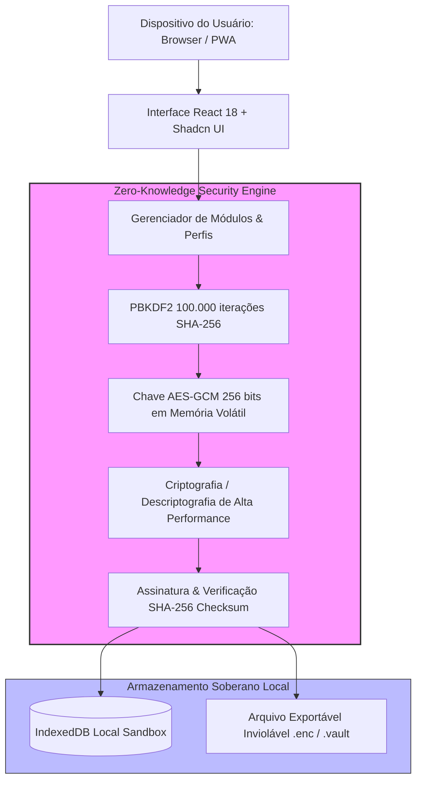

# 🛡️ Safe-Vault
### *Sovereign, Zero-Knowledge & Local-First Personal CRM*

[](https://www.typescriptlang.org/)
[](https://react.dev/)
[](https://developer.mozilla.org/en-US/docs/Web/API/SubtleCrypto)
[](#-3-arquitetura-de-segurança-e-criptografia)
[](#-2-decisões-de-arquitetura-e-engenharia-de-software-adrs)
[](#adr-02-pwa--local-first-vs-aplicativos-nativos-mobile)
[](https://adam-moller.github.io/Safe-vault/)

---

## 📖 1. Visão Geral do Projeto

O **Safe-Vault** é um sistema de gerenciamento de relacionamentos e informações estratégicas (**Personal CRM**) construído sob a premissa de **Soberania Digital**, **Privacidade Absoluta** e **Zero-Knowledge Architecture**.

### O Problema do Software Corporativo Tradicional
Em ambientes corporativos modernos, sistemas centrais de CRM e ERP (Salesforce, SAP, Jira, Totvs) pertencem exclusivamente ao empregador, são monitorados pela TI e submetidos a auditorias legais e compliance corporativo:
* **Perda de Capital Relacional:** Quando um vendedor ou executivo sênior deixa uma empresa, perde o histórico e a inteligência de relacionamento que construiu ao longo de anos.
* **Censura Prática de Informações Sensíveis:** Líderes de equipe e gerentes regionais não podem registrar em sistemas corporativos impressões subjetivas vitais para a tomada de decisão humana (ex: dinâmica de conflito entre subordinados, problemas de saúde pessoal impactando produtividade, fofocas corporativas com relevância operacional, descontentamento de liderados).
* **Vazamento e Intrusão em Nuvem:** Profissionais como advogados, psicólogos e recrutadores lidam com dados que, se armazenados em nuvens públicas de terceiros, tornam-se vulneráveis a vazamentos, intimações e incidentes de ransomware.

### A Solução: *Sovereign Personal Vault*
O **Safe-Vault** devolve a custódia total dos dados ao usuário. **Nenhum dado trafega por servidores externos.** Todas as informações são criptografadas diretamente na memória do navegador utilizando primitivas criptográficas nativas de padrão militar e persistidas no dispositivo do usuário (IndexedDB local) ou em arquivos de backup invioláveis (`.enc` / `.vault`).

---

## 🏛️ 2. Decisões de Arquitetura e Engenharia de Software (ADRs)

Para garantir máxima performance, segurança e portabilidade, este projeto adotou escolhas deliberadas de arquitetura que rompem com o paradigma clássico de backends centralizados:



### ADR 01: TypeScript vs. Java / C# / Python no Backend
* **Decisão:** Execução integral *Client-Side* com TypeScript rigoroso, dispensando completamente backends remotos.
* **Justificativa Técnica:**
  1. **Premissa de Conhecimento Zero (Zero-Knowledge):** Se houvesse um backend em Java/C#, dados descriptografados ou chaves de sessão precisariam trafegar pela rede ou ser manipulados no servidor, criando um ponto único de falha (*Single Point of Failure*) e vetor de interceptação.
  2. **Ambiente de Execução Universal (Universal Runtime):** O ecossistema web roda nativamente em qualquer motor JavaScript moderno (V8 no Chromium, JavaScriptCore no WebKit do iOS/macOS, SpiderMonkey no Firefox) sem necessidade de instalação de JVM, runtimes pesados ou dependências de sistema operacional.
  3. **Segurança de Tipos em Domínios Heterogêneos:** TypeScript oferece tipagem estática estrutural sem overhead de performance em runtime, permitindo validação robusta de esquemas complexos para cinco perfis de negócios distintos.

### ADR 02: PWA & Local-First vs. Aplicativos Nativos Mobile (Android/iOS)
* **Decisão:** Implementação como aplicação web progressiva (*Progressive Web App*) baseada em padrões abertos.
* **Justificativa Técnica:**
  1. **Desburocratização e Resistência à Censura:** Lojas proprietárias (Apple App Store e Google Play Store) impõem diretrizes discricionárias, telemetria obrigatória e processos de aprovação morosos. Um PWA local-first é distribuível instantaneamente, sem intermediários.
  2. **Isolamento de Sandbox do Navegador:** O navegador provê o sandbox de segurança mais testado do planeta. Nenhum dado do cofre é exposto aos rastreadores do sistema operacional nativo.
  3. **Pegada de Recursos Mínima:** Em vez de distribuir executáveis Electron ou pacotes nativos de mais de 150 MB, o PWA consome o motor já presente no dispositivo, gerando bundles ultra-otimizados inferiores a 1 MB compactados.

### ADR 03: Web Crypto API Nativa vs. Bibliotecas de Terceiros (CryptoJS)
* **Decisão:** Uso exclusivo da API `crypto.subtle` nativa do navegador (W3C Web Cryptography Standard).
* **Justificativa Técnica:**
  1. **Mitigação de Ataques à Cadeia de Suprimentos (*Supply-Chain Attacks*):** Bibliotecas NPM de criptografia são alvos frequentes de injeção de código malicioso. O uso da API nativa elimina dependências externas no núcleo de segurança.
  2. **Aceleração por Hardware (AES-NI):** A Web Crypto API é compilada nativamente nos binários dos navegadores em C++, alavancando instruções dedicadas de hardware da CPU para operações AES e SHA-256, eliminando gargalos de CPU e garantindo imunidade a ataques de temporização (*timing attacks*).

### ADR 04: Envelope de Exportação com Checksum SHA-256 Antifraude
* **Decisão:** Criação de um envelope de dados com metadados explícitos e soma de verificação SHA-256 do payload criptografado.
* **Justificativa Técnica:**
  1. **Detecção Antecipada de Corrupção:** Arquivos transferidos via pendrive ou nuvem podem sofrer corrupção de bits (*bit rot*) ou downloads parciais. O cálculo do hash SHA-256 identifica adulterações antes de disparar o dispendioso processo de derivação de chave de 100.000 iterações PBKDF2.
  2. **Interoperabilidade e Versionamento:** Permite migrações transparentes de esquemas entre versões futuras sem quebrar dados legados.

---

## 💼 3. Módulos e Perfis Especializados de Nicho

O Safe-Vault conta com uma arquitetura modular por perfis de domínio:

| Módulo | Público-Alvo | Informações Estratégicas Sigilosas Mapeadas |
| :--- | :--- | :--- |
| **💼 Vendas B2B (*Sales Blackbook*)** | Executivos Comerciais, Vendedores Sênior | Mapeamento de decisores reais, canais pessoais de contato, notas cruas de negociação e carteira própria portável. |
| **🏬 Gestão Regional (*Workforce Vault*)** | Gerentes de Área, Coordenadores de Lojas | Diário de campo, dinâmica interpessoal de filiais, fofocas e notas confidenciais sobre conduta, clima e auditorias. |
| **👔 Headhunting & Talentos (*Talent Vault*)** | Recrutadores Executivos, Consultores de RH | Pacote salarial real (fixo, bônus, equity), motivos não-públicos de saída, cláusulas de não-competição e insatisfação real. |
| **⚖️ Dossiês Confidenciais (*Legal Dossier*)** | Advogados, Investigadores, Compliance | Fontes e testemunhas sigilosas, vulnerabilidades probatórias, pontos fracos do adversário e estratégias pré-litígio. |
| **🩺 Prontuário & Notas Clínicas (*Therapy Vault*)** | Psicólogos, Psicanalistas, Terapeutas | Evolução clínica, alertas de risco de crise, objetivos e anotações protegidas de **Contratransferência** do profissional. |

---

## 🤖 4. Engenharia de Software Acelerada por IA (AI-Augmented Engineering)

Este projeto foi concebido e implementado utilizando **metodologias modernas de engenharia assistida por inteligência artificial**:

* **Arquitetura Orientada por Especificação (*Spec-Driven Design*):** A IA atuou como copiloto técnico para sintetizar contratos de dados rigorosos em TypeScript, modelando entidades de negócios com alto nível de acoplamento contextual.
* **Refatoração Cirúrgica e Respeito a Código Existente:** Alterações nos fluxos centrais de login, IndexedDB e renderização modular foram efetuadas preservando 100% da compatibilidade com versões prévias do repositório.
* **Auditoria Cruzada de Criptografia:** Validação matemática da interoperabilidade entre as primitivas Web Crypto do browser e bibliotecas formais de referência (PyCryptodome / OpenSSL).
* **Testes Automatizados de Importação e Tipagem:** Verificação automatizada de 100 arquivos TypeScript garantindo integridade estrita de caminhos e ausência de dependências órfãs.

---

## 🔐 5. Modelo de Ameaça (Threat Model)

### O que o sistema protege com eficácia:
* ✅ **Vazamentos em Bancos de Dados em Nuvem:** Inexistência de banco de dados remoto; o atacante não tem servidor central para invadir.
* ✅ **Inspeção de Rede e Man-in-the-Middle (MitM):** Como a criptografia ocorre antes do armazenamento, nenhum dado trafega em texto claro.
* ✅ **Acesso por Administradores de TI da Empresa:** Arquivos salvos localmente sob senha mestra não podem ser inspecionados por scripts padrão de backup corporativo.
* ✅ **Adulteração de Backup:** Backups exportados contêm checksum SHA-256 e cifra AES-GCM autenticada.

### O que está fora do escopo (Vetores Locais):
* ⚠️ **Keyloggers e Spywares no Sistema Operacional:** Se o computador hospedeiro estiver infectado por malware no nível do SO, a senha digitada pode ser interceptada no teclado.
* ⚠️ **Esquecimento da Senha Mestra:** Em arquiteturas Zero-Knowledge reais, **não existe botão de "esqueci minha senha"**. A perda da senha implica perda matemática definitiva dos dados.

---

## 🚀 6. Como Executar o Projeto Localmente

### Pré-requisitos
* Navegador moderno com suporte à Web Crypto API (Chrome, Edge, Firefox, Safari, Brave).
* Node.js 18+ ou Bun (para desenvolvimento local).

```bash
# 1. Clonar o repositório
git clone https://github.com/Adam-Moller/Safe-vault.git

# 2. Acessar a pasta do projeto
cd Safe-vault

# 3. Instalar dependências
npm install
# ou bun install

# 4. Iniciar servidor de desenvolvimento
npm run dev

# 5. Build de produção otimizado
npm run build
```

---

## 🌐 Demonstração Online

Acesse a versão em produção via GitHub Pages: [adam-moller.github.io/Safe-vault](https://adam-moller.github.io/Safe-vault/)

---

## 📄 Licença

Distribuído sob a licença **MIT**.
